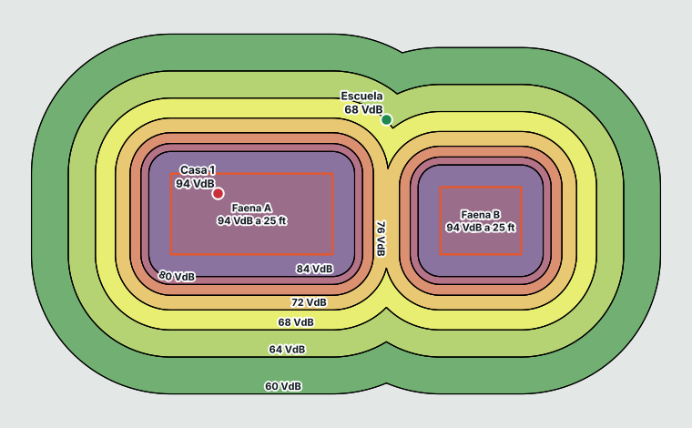

# Vibraciones Decibel

Plugin de QGIS para proyectar vibraciones de construcción según el
**FTA Report No. 0123 (2018), sección 7.2**: nivel de vibración Lv en VdB y
PPV en in/s, desde capas de focos puntuales o áreas de proyecto.



## Funciones

- **Focos de puntos o de áreas.** En las áreas, la distancia se mide al polígono.
- **Catálogo de equipos FTA** (Tabla 7-4) o nivel medido. Lv y PPV a 25 ft
  se pueden calcular desde una medición de PPV en mm/s.
- **Tres modos de proyección:**
  - *Iterativo*: un solo foco.
  - *Suma*: suma logarítmica (energética) del nivel de cada foco.
  - *Lineal*: sin suma; las isolíneas de cada foco que se tocan se
    disuelven y cada receptor toma el nivel de la fuente más cercana.
- **Escala de niveles** por nivel mínimo, paso y cantidad de colores.
  Escalas de color Amarillo → morado, Verde → morado o personalizada.
- **Evaluación de receptores** contra los criterios de molestia (Tabla 6-3) y
  de daño estructural (Tabla 7-5), con memoria de cálculo.
- **Exportación** a GeoPackage y Shapefile con su estilo QML (se ven igual
  al volver a abrirlos), KMZ con leyenda y CSV.

## Metodología

```
Lv(D)  = Lv,ref − 30·log10(D / 25 ft)     [VdB re 1 µin/s]   Ec. 7-3
PPV(D) = PPV,ref · (25 ft / D)^n          [in/s]             Ec. 7-2
```

con 25 ft = 7,62 m y n = 1,5 por defecto (configurable).

## Requisitos

- QGIS 3.28 a 4.x (Qt5 y Qt6).
- Librerías de Python incluidas en las instalaciones habituales de QGIS
  (OSGeo4W en Windows, instalador de macOS): `numpy`, `shapely` y
  `matplotlib`. `scipy` y `contourpy` aceleran el cálculo con varios focos;
  si faltan, el plugin usa alternativas más lentas.

## Instalación

- **Desde QGIS:** *Complementos › Administrar e instalar complementos*, buscar
  "Vibraciones Decibel".
- **Manual:** descargar el ZIP de la [última versión](../../releases) e
  instalarlo desde *Complementos › Administrar e instalar complementos ›
  Instalar desde ZIP*.

## Reportar problemas

Abre un *issue* en [Issues](../../issues) indicando la versión de QGIS, el
sistema operativo y, si aparece, el mensaje de la consola de Python.

## Licencia

[GNU GPL v3.0 o posterior](LICENSE).

Autor: Esteban Vargas Carrera / Decibel.
